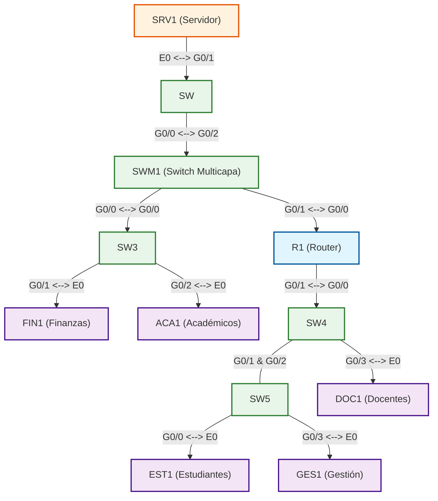

La red empresarial esta formada por dos sitios distintos y  unidos por el enlace SWM1 con R1: el lado izquierdo enruta con el switch capa 3 (SWM1) y el derecho con router-on-a-stick (R1) formando las siguientes conexiones entre los dispositivos:

| Extremo A       | Extremo B       | Funciones                                         |
| --------------- | --------------- | ------------------------------------------------- |
| SRV1 eth0       | SW e0/1         | Acceso, LAN Datacenter                            |
| SW e0/0         | SWM1 e0/2       | Enlace hacia el core izquierdo                    |
| SWM1 e0/0       | SW3 e0/0        | Trunk Finanzas y Académicos                       |
| SW3 e1/0        | FIN1            | Acceso, VLAN Finanzas                             |
| SW3 e2/0        | ACA1            | Acceso, VLAN Académicos                           |
| SWM1 e0/1       | R1 e0/0         | Enlace punto a punto , puerto ruteado             |
| R1 e0/1         | SW4 e0/0        | Trunk dot1Q con subinterfaces (router-on-a-stick) |
| SW4 e0/1 y e0/2 | SW5 e0/1 y e0/2 | Trunk, probablemente EtherChannel                 |
| SW4 e1/0        | DOC1            | Acceso, VLAN Docentes                             |
| SW5 e2/0        | EST1            | Acceso, VLAN Estudiantes                          |
| SW5 e3/0        | GES1            | Acceso, VLAN Gestión                              |
|                 |                 |                                                   |
## **Estructura de la topologia** 

La infraestructura de la red esta construida por los siguientes componentes clave:
- **Dispositivos de Núcleo y Enrutamiento:**
    
    - **R1 (Router Cisco IOSv):** Actúa como el enrutador central y gateway inter-VLAN mediante subinterfaces (`GigabitEthernet0/1.10`, `.20`, `.30`, `.40`).
        
    - **SWM1 (Switch Multicapa):** Gestiona las VLANs departamentales (Finanzas y Académicos) y conecta el servidor principal.
        
- **Switches de Capa 2 (IOSvl2):**
    
    - **SW3, SW4 y SW5:** Distribuyen el tráfico hacia los diferentes departamentos mediante puertos de acceso y enlaces troncales. Utilizan EtherChannel (Port-channel 1) para redundancia de enlaces.
        
- **Servidores y Endpoints (Host de Pruebas):**
    
    - **SRV1 (Servidor de Linux Alpine):** IPv4 `172.20.10.2/26` / IPv6 `2001:25:20:4::2/64`.
        
    - **Equipos finales:** `DOC1` (Docentes), `EST1` (Estudiantes), `GES1` (Gestión), `ACA1` (Académicos), y `FIN1` (Finanzas).

